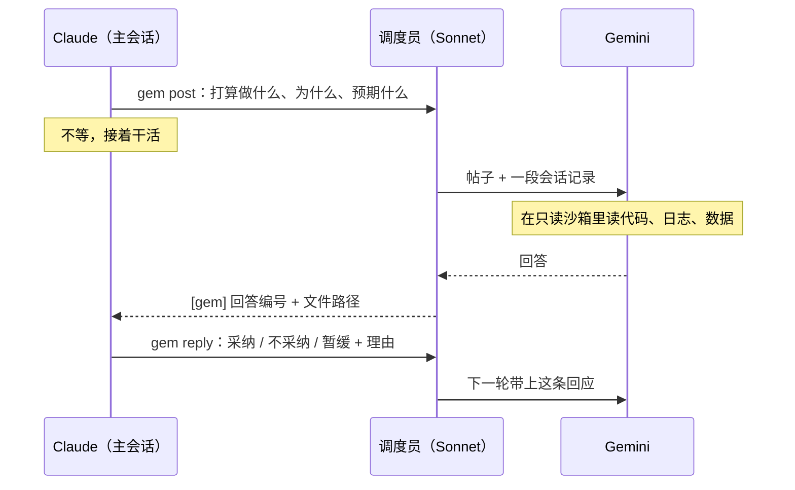

# gemini-consult

让 Gemini 在旁边给 Claude Code 当顾问。Claude 照常干活，Gemini 异步看它的打算和进展，在要紧的地方给第二意见。拍板的始终是 Claude 和你。

*A Claude Code skill: Gemini (via Antigravity CLI) advises Claude asynchronously, with a Sonnet session deciding when to ask and when to deliver. Docs are in Chinese.*

## 为什么这样做

让另一个模型帮忙把关，直接做会遇到三个问题：

- **一个模型自己干长任务，容易一条路走到黑。** 误读一个结果、过早下一个结论，后面全跟着错。换一个模型从外面看，更容易发现。
- **同步审查太慢。** Gemini 4 Argon（high）想一轮要几分钟到十几分钟。每一步都让 Claude 停下来等，整个任务就被拖住了。
- **两个模型直接对话，会互相带偏。** Claude 在正文里讨论 Gemini 的意见，Gemini 下一轮又读到这段讨论，几轮之后两边说的是同一套话。

这个 skill 的做法：

- **异步。** Claude 有了打算就写下来发出去，然后接着干。只有在不可逆的一步之前、给你下结论之前，才停下来等回答。
- **由第三方管时机。** 一个 Sonnet 会话当调度员：什么时候问、问哪个 Gemini 对话、什么时候把回答交回去，都由它决定。它不评判内容，也不改写回答。
- **信息只按设计的路线走。** Gemini 读到的会话记录里，去掉了双方的往来。Claude 对它的反馈只有一句：采纳、不采纳或暂缓，再加一句理由。

## 怎么运作



| 角色 | 是什么 | 做什么 |
|---|---|---|
| 主会话 | 你正在用的 Claude Code 会话 | 干活；有打算就发帖；读回答，逐条回应 |
| 调度员 | 主会话自己开的一个 Sonnet 会话 | 把帖子交给合适的 Gemini 对话，决定附上多少会话记录、什么时候催、什么时候把回答递回去 |
| Gemini | `agy` 跑的 Gemini 对话，可以同时开几个 | 在只读沙箱里读项目和会话记录，按固定格式给意见 |

### 一个例子

Claude 在调一个训练任务，发现 loss 在第 2000 步之后开始震荡。

1. 它打算降学习率。动手之前先发帖：

   ```bash
   gem post "第 2k 步后 loss 震荡。打算把 lr 从 3e-4 降到 1e-4 重跑。预期震荡消失，最终 val loss 持平或略好。改完配置大约 10 分钟后开跑。"
   # 输出 P0003
   ```

2. Claude 接着改配置，不等。
3. 调度员看到新帖，把它交给一直跟着主会话的 Gemini 对话 `follow`，附上主会话最近这一段记录。
4. Gemini 读了训练脚本和日志，回答的第一行是：

   ```
   方向问题：震荡从 warmup 结束那一步开始，更像是学习率调度的问题，不是 lr 本身太大
   ```

   后面写着依据，比如 `[数据] logs/train.log 第 1998–2010 步`。

5. 调度员判断这条要赶在开跑前给，于是发给主会话：

   ```
   [gem] follow#004（帖子 P0003）：…/.gemini-consult/convs/follow/out/004.md。方向问题，赶在开跑前给
   ```

6. Claude 读完原文，回应：

   ```bash
   gem reply follow#004 采纳 "先只加长 warmup，lr 不动，跑一次对照"
   ```

   Gemini 下一轮会看到这条回应。

### 几个说法

- **帖子**（如 `P0003`）：Claude 写下的一条打算，说清做什么、为什么、预期看到什么。帖子不是提问，是"我准备这么做了"。改目标、定新计划、把结果解读成结论、放弃一条线，属于方向性的帖子，发的时候加 `--dir`。
- **对话**：一个 Gemini 会话，可以续很多轮。`follow` 一直跟着主会话，处理细节。方向性的帖子单独开一个 `q-<短名>`，让 Gemini 不受之前的讨论影响，独立判断。
- **回答编号**（如 `follow#004`）：某个对话的第几轮回答，对应文件 `.gemini-consult/convs/follow/out/004.md`。
- **会话快照**：从 Claude 的会话记录里截出来、给 Gemini 读的一段。里面去掉了 `gem` 命令、调度员的消息、顾问目录的读写；读过的文件只留路径，内容让 Gemini 自己去读。
- **距离**：Gemini 读到的那一刻之后，主会话又发生了多少：你发了几轮、后台通知几轮、Claude 新发了几帖、过了几分钟。这只是给调度员看的记录，不会自动触发任何动作。

## 要求

- **Claude Code 桌面版。** 调度员会话是主会话用 `start_session` 开的，回答用 `SendMessage` 递，这两个工具只有桌面版有。通过 SSH 连到远程机器的会话也可以。
- **Antigravity CLI（`agy`）**，已登录，能用 Gemini 4 Argon。模型可以在配置里换。
- **Python 3.9+**，只用标准库。
- **Linux + bubblewrap（`bwrap`）**，用来跑沙箱。macOS 或装不了 bwrap 的机器可以设 `GEM_SANDBOX=off`，代价见[安全](#安全gemini-能看到什么)。

## 安装

### 1. 下载

**项目级（推荐）**：只给这个项目用，状态也放在这个项目里。

```bash
git clone https://github.com/fujioky/gemini-consult.git <项目>/.claude/skills/gemini-consult
```

**用户级**：所有项目都能用。项目目录取运行时的当前目录，也就是 Claude 会话所在的目录。

```bash
git clone https://github.com/fujioky/gemini-consult.git ~/.claude/skills/gemini-consult
```

不用 git 的话，下载 [zip](https://github.com/fujioky/gemini-consult/archive/refs/heads/main.zip)，解压后把 `gemini-consult-main` 改名成 `gemini-consult`，放到上面任一位置。

以后更新：

```bash
git -C <skill 目录> pull
```

### 2. 别把状态目录提交进 git

状态都写在 `<项目>/.gemini-consult/` 里：

```bash
echo '.gemini-consult/' >> <项目>/.gitignore
```

### 3. 自检沙箱

在项目目录里运行：

```bash
<skill 目录>/gem selftest
```

通过的话，大致是这样：

```
  ✓ 能读项目
  ✓ 项目写不进
  ✓ 家目录写不进
  ✓ 遮住 /home/you/.ssh
  ✓ 遮住 /home/you/.claude
  …
  ✓ 本对话的 in/ 能读
  ✓ 别的对话遮住
  ✓ in/ 只读
  ✓ ~/.gemini 可写
  ✓ 能读 gemini.md
自检通过
```

自检只检查沙箱，不调用 `agy`。`agy` 本身能不能用，在终端里随便问它一句就知道。

### 4. 配置（可选）

`<项目>/.gemini-consult/config.json`：

```json
{
  "model": "gemini-4-argon-high",
  "max_running": 4,
  "mask": ["~/.config/some-private-tool", "/path/to/other/repo/.secrets"]
}
```

| 字段 | 默认 | 作用 |
|---|---|---|
| `model` | `gemini-4-argon-high` | 传给 `agy --model` |
| `max_running` | `4` | 最多同时跑几轮 Gemini，多出来的排队 |
| `mask` | 空 | 除了默认遮住的凭据，再对 Gemini 藏起哪些路径，可以用 `~` |

`<项目>/.gemini-consult/brief.md`：给 Gemini 的项目背景，一页以内就够，写清项目目标、现在做到哪、什么样的结果算好。没有这个文件，Gemini 第一轮会自己去读 README、CLAUDE.md 或 AGENTS.md。

还可以用环境变量覆盖：

| 变量 | 作用 |
|---|---|
| `GEM_PROJECT` | 项目目录 |
| `GEM_ROOT` | 状态目录（默认 `<项目>/.gemini-consult`） |
| `GEM_SANDBOX=off` | 不用沙箱 |
| `GEM_MODEL`、`GEM_MAX_RUNNING` | 同 `config.json` 里的 `model`、`max_running` |

## 使用

### 让 Claude 用起来

临时用，就直接对 Claude 说：

> 这次用 gemini-consult，做计划和下结论之前先问 Gemini。

想一直用，就在项目的 `CLAUDE.md` 里加一行：

```markdown
做计划、换方向、下结论、跑贵的或不可逆的任务之前，先用 gemini-consult skill 问 Gemini。
```

之后 Claude 会按 `SKILL.md` 自己开工：登记自己，开一个调度员会话，然后发帖、读回答、回应。你不需要手动运行任何命令。

### 你会看到什么

- 侧栏多出一个"Gemini 调度员"会话。它第一轮结束时会给主会话发一次汇报，之后在后台干活。
- 主会话里时不时收到以 `[gem]` 开头的消息。Claude 会去读回答原文，然后 `gem reply`。
- Claude 给你总结时，用到了 Gemini 的意见，会注明出处。
- 你**不会**看到 Claude 在正文里讨论"Gemini 怎么说"。这是故意的：正文会进会话记录，下一轮被 Gemini 读到，两边就互相带偏了。

### 自己看进度

```bash
<skill 目录>/gem board   # 新帖、还没递的回答、在跑的轮次、还没转给 Gemini 的回应
<skill 目录>/gem ls      # 每个 Gemini 对话的状态
```

所有东西都是普通文件，可以直接打开看：

```
.gemini-consult/
├── config.json           配置（可选）
├── brief.md              项目背景（可选）
├── main.json             主会话、调度员的会话 ID，主会话记录的路径
├── board/P0003.json      帖子
├── replies.jsonl         Claude 的回应
├── delivered.jsonl       已经递给 Claude 的回答
└── convs/follow/
    ├── meta.json         agy 对话 ID、第几轮、状态
    ├── in/004.md         第 4 轮发给 Gemini 的消息
    ├── in/004-snap.md    第 4 轮附带的会话快照
    ├── out/004.md        第 4 轮的回答
    └── run/004.log       agy 的错误输出
```

### 停下来

关掉调度员会话，就不会再有新的轮次。已经在跑的 Gemini 轮次会自己跑完；想立刻停，运行 `gem close <对话名>`。

## 安全：Gemini 能看到什么

每一轮 Gemini 都在 bubblewrap 沙箱里跑：

| 范围 | Gemini 的权限 |
|---|---|
| 项目目录、家目录 | 只读 |
| 常见凭据：`~/.ssh` `~/.aws` `~/.azure` `~/.kube` `~/.docker` `~/.gnupg` `~/.codex` `~/.config/gh` `~/.config/gcloud` `~/.netrc` `~/.git-credentials` `~/.npmrc` `~/.pypirc`，以及 `mask` 里的路径 | 看不到 |
| `~/.claude`（Claude 的原始会话记录、记忆） | 看不到，只给它过滤后的快照。skill 装在这下面时，只露出 skill 目录本身 |
| 本轮的输入 | 只读 |
| 别的 Gemini 对话 | 看不到 |
| `~/.gemini`、`~/.cache` | 可写，`agy` 自己要用 |
| 跑命令 | 可以，比如用 Python 打开数据文件重算一个数，同样受上面这些限制 |
| 网络 | 不隔离，`agy` 本来就要联网 |

注意：家目录和项目以外的路径（比如 `/tmp`、挂载的数据盘）没有改成只读，权限和你本人一样。

设了 `GEM_SANDBOX=off` 时，以上都不成立：Gemini 能读你这个用户能读的一切。这时只靠 `agy` 的工具白名单兜底，只放行读文件、列目录、glob、grep，不能跑命令。

## 命令速查

一般不用手动运行，Claude 和调度员会按 `SKILL.md`、`broker.md` 调用。排查问题时有用。

| 谁用 | 命令 | 作用 |
|---|---|---|
| 主会话 | `gem main --scratchpad <路径> --session <会话ID>` | 登记主会话 |
| | `gem broker <会话ID>` | 登记调度员 |
| | `gem post [--dir] "<打算>"`，或 `gem post -f <文件>` | 发帖，输出帖子编号 |
| | `gem reply <回答编号> 采纳\|不采纳\|暂缓 "<理由>"` | 回应一条回答 |
| | `gem wait <帖子> [--long]` | 等这个帖子的回答；`--long` 放后台用，最多等两小时 |
| 调度员 | `gem watch` | 有事件就退出；10 分钟没事就打印 `quiet` 后退出 |
| | `gem open <名字> --kind follow\|question --post <帖子> [--snap \| --snap-from-byte N]` | 新开对话 |
| | `gem say <名字> --post <帖子> [--snap] [--anyway]` | 在已有对话里续一轮 |
| | `gem nudge <名字>` | 停下当前这一轮，让它按已经看到的先给看法 |
| | `gem read <名字>`、`gem delivered <回答编号>`、`gem close <名字>` | 列回答、记下已递送、关闭对话 |
| 都可以 | `gem board`、`gem ls` | 看全局、看对话 |
| | `gem selftest` | 检查沙箱 |

## 设计上的取舍

- **催不催，看主会话走了多远，不看钟点。** 训练跑着的时候，可能一个小时没人说话，只有后台通知在刷，这时让 Gemini 慢慢想就好。你连发了几轮、Claude 已经去做别的事了，才该催。所以 `gem` 只记录距离，催不催由调度员判断。
- **方向性的问题单独开对话。** 同一个对话续得越久，越容易顺着之前的思路走。方向性的帖子新开对话，独立判断；细节续在 `follow` 里，省得每次都重读整个项目。
- **催促就是停下再问。** 实测 `agy` 的一轮被中途停掉后，再续这个对话，它还记得之前读过的文件，所以催一下不会浪费它已经做的工作。
- **不在终端起 `claude`。** `claude -p` 这类调用按 API 计费，不走订阅额度。需要摘要时，由调度员自己写。
- **快照要够快。** 按字节位置接着上次读，先按行首跳过记账行再解析。两亿字节的会话记录从头截约 0.3 秒，增量截一次零点几秒。

## 已知限制

- 依赖 Claude Code 会话记录（jsonl）的格式，比如 `turnOrigin` 字段。Claude Code 改了格式，`snapshot.py` 可能要跟着改。
- Gemini 的对话 ID 是靠比对 `~/.gemini/antigravity-cli/conversations/` 里新出现的 `.db` 文件认出来的。`agy` 换了存储方式就会失效。
- 沙箱只把家目录和项目设成只读，其他路径不变（见[安全](#安全gemini-能看到什么)）。
- 只在一台 Linux 机器上实测过。macOS 上只能用 `GEM_SANDBOX=off`，还没测过。

## 文件

| 文件 | 给谁 | 内容 |
|---|---|---|
| `SKILL.md` | 主会话 | 怎么开工、发帖、回应、等待 |
| `broker.md` | 调度员 | 能决定什么、不能做什么、续旧对话还是新开、事件怎么处理 |
| `gemini.md` | Gemini | 角色、回答格式、来源标注 |
| `gem` | 都用 | 唯一入口：帖子、对话、快照、递送记录 |
| `snapshot.py` | `gem` | 从 Claude 会话记录里截一段给 Gemini，去掉顾问往来 |
| `agy_consult.sh` | `gem` | 只读沙箱和自检 |
| `agy_settings*.json` | `agy` | 工具白名单 |
